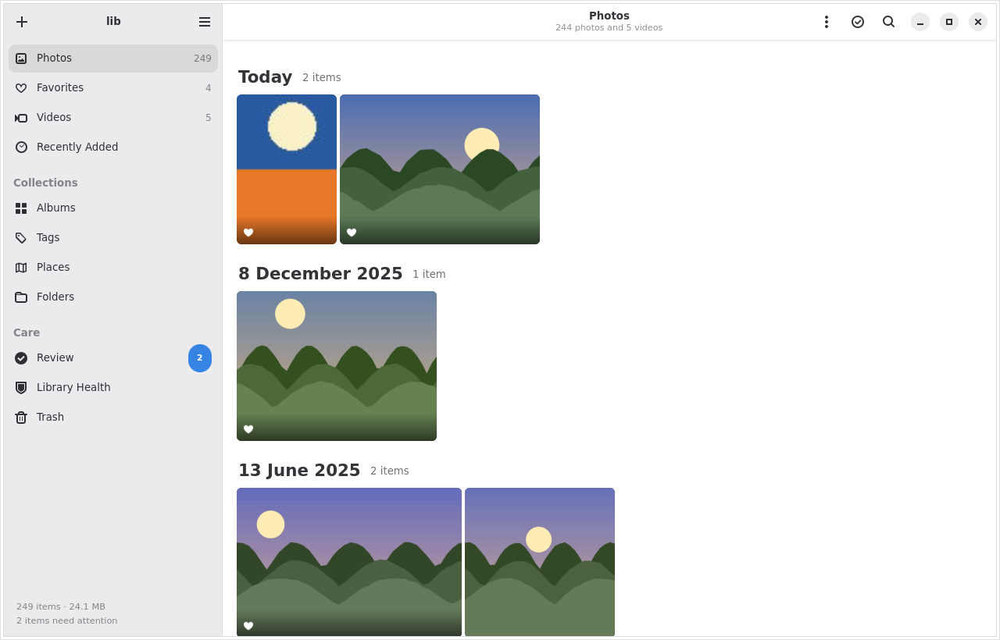
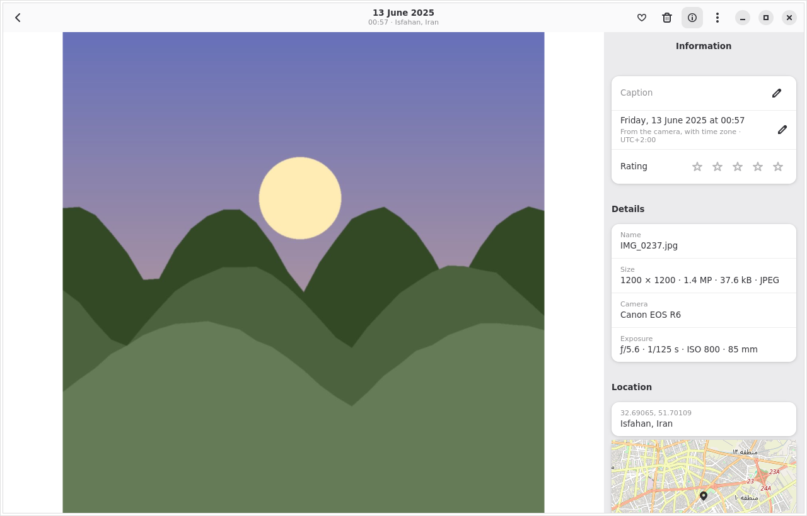
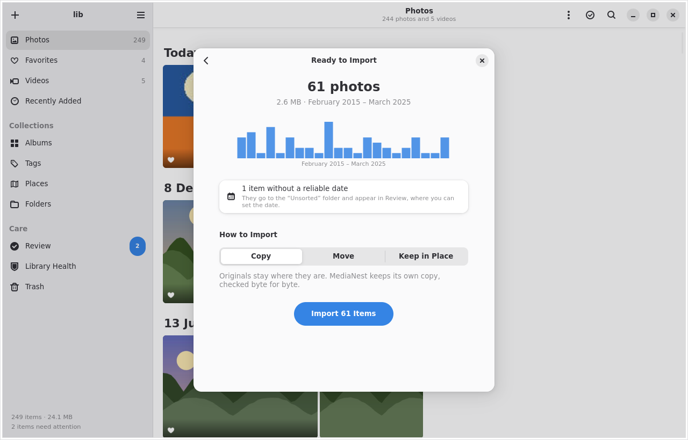
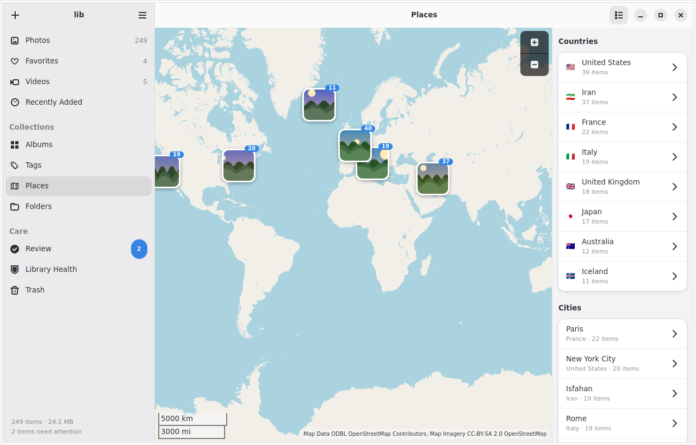

<div align="center">
  
  <h1>MediaNest</h1>
  <p><strong>A calm, private home for your photos and videos on Linux.</strong></p>
</div>



MediaNest copies photos and videos from cameras, phones and folders into one
library on your disk, files them by the date they were taken, and checks
every copy byte for byte before anything else happens. Your originals are
never modified, nothing is ever overwritten, and every deletion can be
undone.

It is a native GNOME application written in Rust with GTK 4 and libadwaita,
and runs on Wayland and X11.

## Features

- **A fast timeline.** Photos grouped by day or month, justified or square
  tiles, five zoom levels, a date scrubber, and smooth scrolling with
  hundreds of thousands of items.
- **Safe imports.** See what an import would do before anything is copied:
  how many new items, which are already in the library, which have no
  reliable date. Copy, move (each original is removed as soon as its copy
  is verified, so two copies never pile up), or keep a folder in place and watch it.
- **Organise.** Albums, smart albums that fill themselves from a search,
  tags, ratings, favorites, captions, hiding, rotation and date
  corrections — for one item or a thousand, with undo.
- **Find anything.** Search words, places, cameras, tags, albums and dates
  (`beach`, `place:Paris`, `tag:family -tag:work`, `2023`, `july`,
  `rating>=4`, `is:video`), with suggestions while you type.
- **Places.** A map of where photos were taken. Place names come from an
  offline database; map images are optional.
- **Formats.** JPEG, PNG, WebP, GIF, TIFF, HEIC/HEIF, AVIF, JPEG XL, RAW
  previews, common video formats, Apple Live Photos and Android motion photos.
- **Look after the library.** A review inbox for photos without dates,
  missing or changed files and interrupted operations; near-duplicate
  detection; periodic re-verification of every file; catalog backups.
- **Keyboard first.** Every action has a shortcut; press `Ctrl+?` to see them.
- **A command-line tool**, `medianest-cli`, for scripting and servers.

| | |
|---|---|
|  |  |
|  | |

## Installing

### Debian 13 (trixie) or newer

Build a package and install it:

```sh
sudo apt install cargo pkg-config libgtk-4-dev libadwaita-1-dev \
    libshumate-dev libheif-dev gettext dpkg-dev
scripts/build-deb.sh
sudo apt install ./dist/medianest_1.0.0_amd64.deb
```

The package recommends `ffmpeg` (video thumbnails and JPEG XL) and the
GStreamer plugins that play videos.

### From source, any distribution

Requirements: Rust 1.85 or newer, GTK 4.18, libadwaita 1.7, libshumate 1.4,
libheif 1.19, and at runtime `ffmpeg`/`ffprobe` plus GStreamer for playback.

```sh
PREFIX=$HOME/.local scripts/install.sh      # just for you
sudo scripts/install.sh                     # for everyone, into /usr/local
```

### Flatpak

A manifest is in [`build-aux/`](build-aux/):

```sh
flatpak-builder --user --install build build-aux/io.github.mmrzaf.MediaNest.json
```

## Using MediaNest

Start it from your applications and choose **Create New Library**. A library
is an ordinary folder:

```
Photo Library/
├── Media/
│   ├── 2023/07/14/IMG_1234.HEIC
│   ├── 2023/07/14/IMG_1234.MOV
│   └── Unsorted/scan_0001.jpg      ← no reliable date yet
└── .medianest/                     ← catalog, backups; managed by MediaNest
```

Your photos stay usable without MediaNest: they are plain files in plain
folders. The [user guide](docs/guide.md) explains importing, organising,
searching, the review inbox and keeping a library healthy.

The command-line tool works on the same libraries:

```sh
medianest-cli init ~/Pictures/Photo\ Library
medianest-cli -L ~/Pictures/Photo\ Library import --dry-run /media/me/CAMERA/DCIM
medianest-cli -L ~/Pictures/Photo\ Library search 'place:paris 2023 is:fav'
```

Run `medianest-cli --help` for every command; add `--json` for
machine-readable output.

## Safety

MediaNest is built around not losing photos:

- Originals are only ever read. Edits live in the catalog.
- Files are installed with no-replace renames, so nothing is overwritten.
- Each copy is hashed (BLAKE3) and compared with the original before it
  counts. Moving removes the original only if it is still exactly the file that was
  copied, and keeps it for your review otherwise.
- Every multi-step operation is journaled; an interruption at any moment —
  a crash, a pulled cable, a power cut — is completed or rolled back the
  next time the library opens. The test suite simulates a crash at every step.
- Deleting moves files to the system trash.
- Every file is re-read periodically to catch silent damage, and the
  catalog is backed up automatically.

Details are in [the library format](docs/library-format.md) and
[the architecture notes](docs/architecture.md).

## Building and developing

```sh
cargo build                 # everything
cargo run -p medianest-app  # the application
scripts/check.sh            # formatting, lints, tests and a release build
```

The workspace has seven crates: `core` (types and the search language),
`catalog` (SQLite), `media` (probing, decoding, thumbnails, place names),
`vault` (journaled file operations), `service` (the running library),
`cli` and `app`. See [docs/architecture.md](docs/architecture.md).

Translations use gettext; see [po/README.md](po/README.md).

## License

MediaNest is released under the [MIT License](LICENSE).

Place names are derived from [GeoNames](https://www.geonames.org) data,
licensed under CC BY 4.0. Map images © OpenStreetMap contributors.
